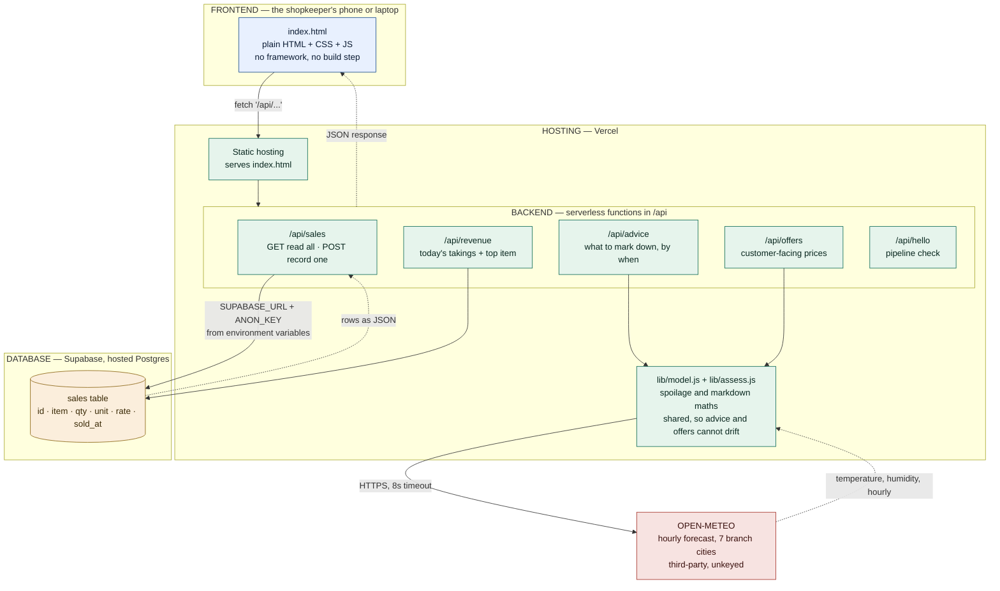
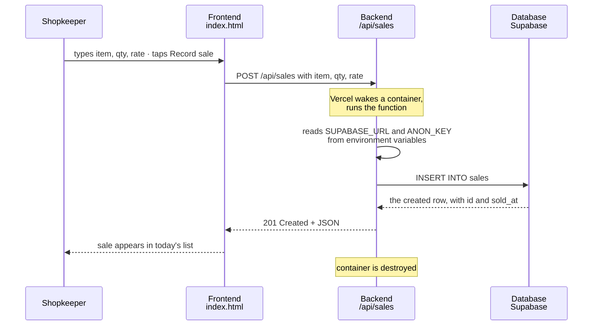

# Mittal Sweets — Architecture

Session 5 homework. The four parts of this app, what each one does, and how a
single request travels through all of them.

Mittal Sweets is a sweet shop. Two problems are being solved: the counter has no
record of what sold today, and mithai spoils faster in heat and humidity than the
shopkeeper can judge by eye.

---

## The four parts

| Part | What it is here | Why it exists |
|---|---|---|
| **Frontend** | `index.html` — plain HTML, CSS and JavaScript. No framework, no build step. | What the shopkeeper actually touches: buttons to read today's revenue and a form to record a sale. |
| **Backend** | Serverless functions in `/api`. Plain Node.js, one file per endpoint. | Holds the logic and the secrets. The browser is never trusted with the database key. |
| **Database** | Supabase — a hosted Postgres database. One `sales` table. | Makes data survive. Without it, every sale recorded vanishes on refresh. |
| **Hosting** | Vercel. Serves the static page and runs the functions on demand. | Turns files on a laptop into something reachable from the shop counter. |

One outside service: **Open-Meteo**, an hourly weather forecast API. Unkeyed, so
there is no secret to protect on that path.

---

## The diagram

**A note on how this is actually deployed.** The diagram shows the product as
one system, which is how it works from the shopkeeper's side. It currently ships
as **two Vercel projects**: `mittal-sweets-api` holds `/api/hello`,
`/api/revenue` and `/api/sales` with the Supabase connection, and
`mittal-sweets-weather` holds `/api/branches`, `/api/advice` and `/api/offers`
with the Open-Meteo call. They were built in separate sessions. Merging them is
a deployment change, not an architectural one — the parts and the flows above
stay exactly the same.

---

## Trace one request

The shopkeeper sells 2 kg of Gulab Jamun and taps **Record sale**.

Four parts, one tap. The frontend captured it, the backend applied the rules and
held the key, the database made it permanent, and hosting made the whole thing
reachable from the shop.

---

## What breaks if one part is missing

- **No backend** — the Record sale button looks fine and does nothing. Or worse,
  the database key ends up in the page source where any visitor can read it.
- **No database** — every sale recorded today disappears on refresh, and two
  people at two counters cannot see the same numbers.
- **No hosting** — it runs at `localhost:3000` and nobody outside the laptop can
  reach it.

Reachable and durable are separate wins. Deploying to Vercel made it reachable.
Adding Supabase made it durable. Either one without the other is still broken.

---

## Why SQL and not NoSQL

Sales are a ledger: fixed columns, every row the same shape, and totals that must
add up. Postgres enforces that the amount is a number and the date is a date, so
a bad row is rejected at write time rather than discovered when revenue looks
wrong. Money belongs in a relational database.

---

## If the owner wanted to update things himself

Right now the product catalogue — names, prices, cost, shelf-life tier — is a
constant in `lib/catalog.js`, so changing a price means editing code and
redeploying. **Me.**

To hand that over, the catalogue would have to move out of the file and into its
own Supabase table, sitting alongside `sales`. The functions would read it at
request time instead of importing it. Then the owner needs a screen to edit it,
which means a login — because a page that can change prices cannot be open to
everyone. So: one more table, one more set of endpoints for reading and writing
it, and authentication, which the app currently has none of.

---

## Hosting, and what it costs

| Part | Tool | Free tier |
|---|---|---|
| Frontend + backend | Vercel Hobby | Yes — static hosting and serverless functions |
| Database | Supabase | Yes — 500 MB Postgres |
| Weather | Open-Meteo | Yes — unkeyed, non-commercial use only |
| Code | GitHub | Yes |

The Open-Meteo licence is the one to watch: free for non-commercial use, so a
real shop running this would need a paid tier.

---

## Secrets

`SUPABASE_URL` and `SUPABASE_ANON_KEY` live in `.env.local`, which is listed in
`.gitignore` and has never been committed. `.env.local.example` is committed
instead, showing the variable names with no values. On Vercel the same two
variables are set in the project's environment settings.

A key in the frontend is readable by anyone who opens View Source. That is the
main reason the backend exists at all: the browser asks `/api/sales`, and only
the function talks to the database.
